<div align="center">

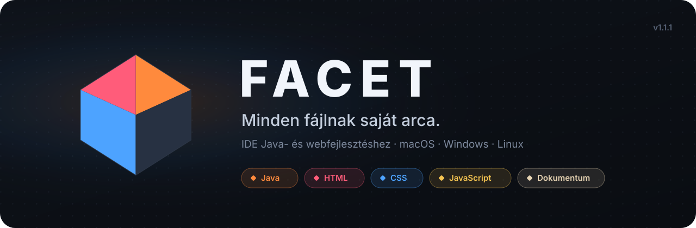

<br>

<a href="https://github.com/BBencht/FacetCode/releases/latest"></a>


<a href="https://github.com/BBencht/FacetCode/actions"></a>
<a href="LICENSE"></a>

<h3>A fejlesztői környezet, ami átalakul ahhoz, amin épp dolgozol.</h3>

Nyiss meg egy `.java` fájlt, és Java-eszközöket kapsz. Egy `.py`-nál lépésenkénti futtatást,<br>
egy `.html`-nél élő előnézetet, egy `.docx`-nél szövegszerkesztőt. Az eszköztár, a panelek, a színek és a parancsok<br>
mindig a fájl típusához igazodnak, és **minden magyarul szól hozzád.**

<br>

[**⬇&nbsp; Letöltés**](#letoltes) &nbsp;·&nbsp; [**Funkciók**](#funkciok) &nbsp;·&nbsp; [**Képek**](#java) &nbsp;·&nbsp; [**Billentyűk**](#billentyuk) &nbsp;·&nbsp; [**Forrásból**](#forrasbol)

<br>

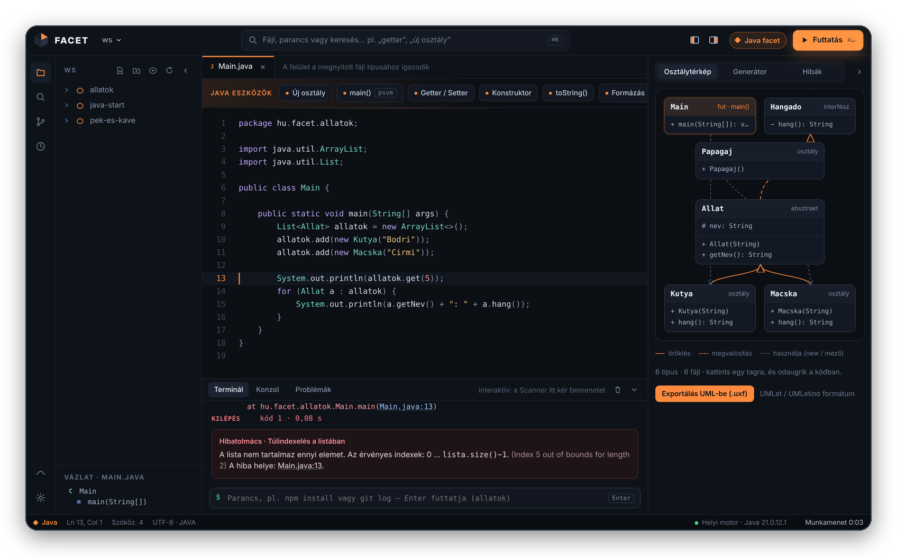

</div>

<br>

<a id="funkciok"></a>

## ◆ Egy IDE, sok arc

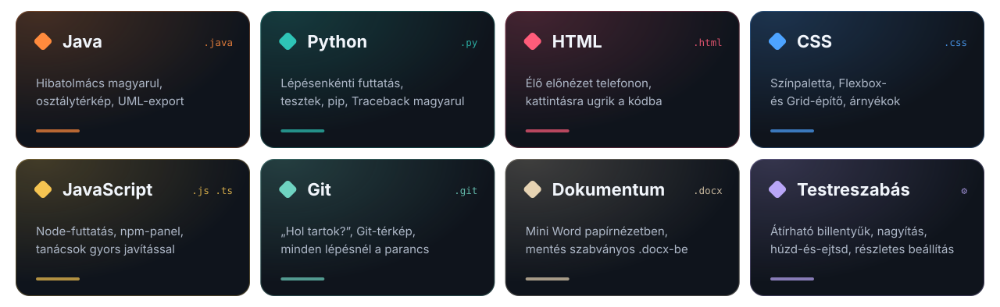

> [!TIP]
> Nem kell semmit átállítanod. A FACET a fájl kiterjesztéséből tudja, mire van szükséged, és a felület egy pillanat alatt átalakul. A <kbd>⌘K</kbd> / <kbd>Ctrl+K</kbd> parancspaletta mindig az aktuális facet parancsait mutatja elöl, és érti, ha magyarul keresel: „getter”, „új osztály”, „formázd”.

<br>

<a id="java"></a>

## ☕ Java

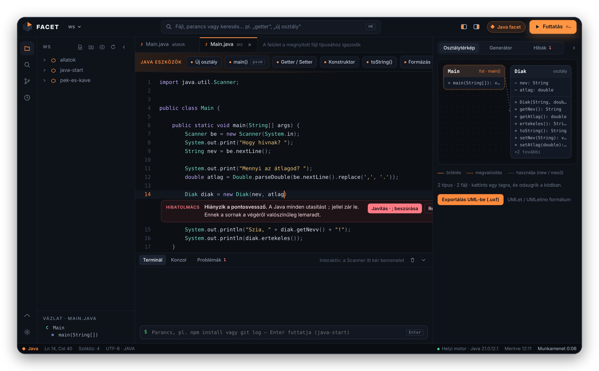

**A Hibatolmács** a fordító angol hibáit magyarul magyarázza el, közvetlenül a hibás sor alatt, és egy kattintással ki is javítja őket. Futás közbeni kivételnél megmondja, mi történt, és a saját kódod pontos sorára ugrik.

<details>
<summary><b>Az összes Java-funkció</b></summary>
<br>

| | |
|---|---|
| 🩺 **Hibatolmács** | Hiányzó `;`, hiányzó import, „Erre gondoltál: getNev?”, rossz fájlnév, `NullPointerException`, túlindexelés, `NumberFormatException`… magyarul, javítással. |
| 💡 **FACET-tanácsok** | Észreveszi a kezdő csapdákat: szövegek összehasonlítása `==`-vel, `nextInt()` után üres sort olvasó `nextLine()`. |
| ⌨️ **Interaktív futtatás** | A `Scanner` bemenetét közvetlenül a terminálba írod, parancssori argumentumokkal együtt. |
| 🗂️ **Okos projekthatárok** | Mint az IntelliJ-ben: `src/`, `.iml`, `pom.xml`, Gradle. Egy mappában lehet sok `Task01`, `Task02`… saját `Main`-nel. |
| 🧭 **Osztálytérkép** | Élő diagram öröklődéssel, interfészekkel és használati kapcsolatokkal. Egy tagra kattintva odaugrik a kódban. |
| 📐 **UML-export** | Egy gombnyomással `.uxf` diagram UMLethez és UMLetinóhoz: mezők, metódusok, láthatóság, kapcsolatok. |
| ⚙️ **Generátorok** | Getter/setter, konstruktor, `toString()`, `equals()`/`hashCode()`, `main`, új osztály, interfész, enum, record. |
| ✍️ **Kódírás** | Kiegészítés automatikus importtal, sablonok (`sout`, `psvm`, `fori`, `scanner`, `readint`…), formázó. |

</details>

<br>

## 🐍 Python

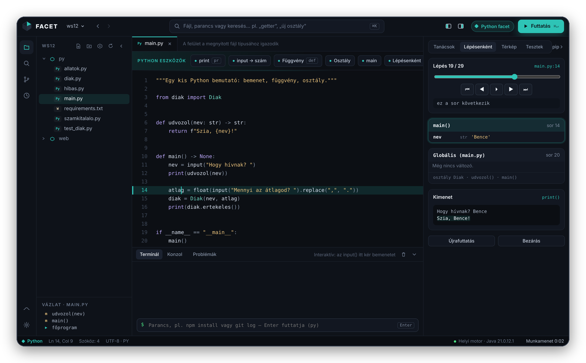

**Lépésenkénti futtatás:** csúszkával lépkedhetsz előre és hátra a programban. Látod, melyik sor fut, milyen függvényhívásokban vagy, és mi van épp a változókban (a változás kiemelve). Az `input()`-ra adott válaszokat előre megadhatod.

<details>
<summary><b>Az összes Python-funkció</b></summary>
<br>

| | |
|---|---|
| ▶️ **Futtatás** | Interaktív terminál: az `input()`-ra közvetlenül válaszolsz. Ha van a projektben `.venv`, azzal fut. |
| 🩺 **Traceback magyarul** | `IndentationError`, `NameError`, `TypeError: can only concatenate str…`, `ValueError: invalid literal for int()`, hiányzó modul… — magyar magyarázat, és ugrás a hibás sorra. |
| ✅ **Élő ellenőrzés** | Mentéskor szintaxis-ellenőrzés futtatás nélkül, a hiba azonnal piros. |
| 💡 **Tanácsok javítással** | `== None` → `is None`, módosítható alapérték, csupasz `except:`, tab/szóköz keveredés, `"Szia " + nev` → f-string, fel nem használt import, beépített név felülírása… |
| 🧭 **Térkép és UML** | Modulok, osztályok, öröklés és használat diagramon; exportálás `.uxf`-be (UMLet). |
| 🧪 **Tesztek** | `pytest` vagy `unittest` egy kattintással: zöld/piros lista, „ezt adta – ezt várta” magyarázat, ugrás a hibás tesztre. Tesztfájlt is generál. |
| ✍️ **Generátorok** | Docstring, `__init__` a mezőkből, `__repr__`, getter/setter (`@property`), átalakítás `@dataclass`-szá. |
| 📦 **pip-panel** | Csomag telepítése, `requirements.txt` kezelése, `.venv` létrehozása egy gombbal. |
| 🐚 **Konzol** | Python-konzol (REPL) a terminálban, vagy „futtatás, utána konzol” (`python -i`). |
| 🖌️ **Formázás** | `black`-kel, ha telepítve van (ha nincs, felajánlja a telepítését). |

</details>

<br>

## 🌐 HTML

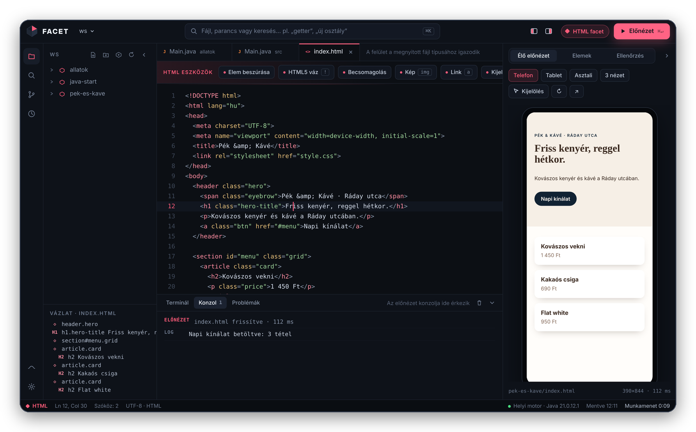

**Élő előnézet** telefon-, tablet- és asztali keretben, vagy mindhárom egyszerre. Gépelés közben frissül, mentés nélkül. Kattints egy elemre az előnézetben, és a kurzor a HTML pontos sorára ugrik.

<details>
<summary><b>Az összes HTML-funkció</b></summary>
<br>

- **Oldal-ellenőrzés:** hiányzó `alt`, viewport, címsorrend, ismétlődő `id`, hiányzó fájlok.
- **Elempaletta:** navigáció, kártya, űrlap, táblázat… egy kattintással.
- **Emmet:** `ul>li*3` + <kbd>Tab</kbd>.
- **Konzol:** az oldal `console.log`-jai és hibái a FACET-ben jelennek meg.

</details>

<br>

## 🎨 CSS

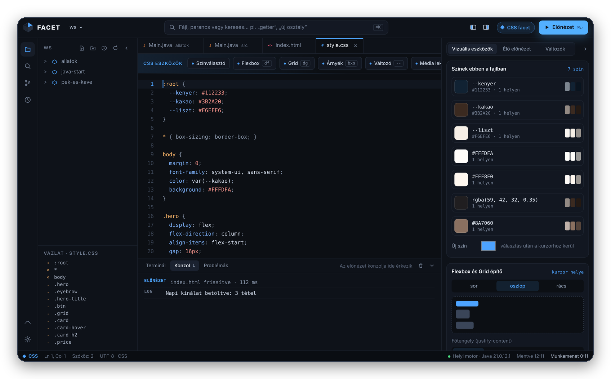

**A fájl összes színe egy helyen**, egy kattintásos átszínezéssel. Mellette Flexbox- és Grid-építő, árnyéktervező és CSS-változó szerkesztő. Az előnézet gépelés közben frissül.

<br>

## ⚡ JavaScript

- **Futtatás Node.js-ben** interaktív terminállal. Ha a szkriptet egy HTML-oldal tölti be, a FACET az élő előnézetben futtatja.
- **Magyar hibamagyarázat** a Node és a böngésző hibáihoz (`ReferenceError`, `Cannot read properties of undefined`, hiányzó csomag…).
- **Tanácsok gyors javítással:** `==` → `===`, `var` → `let`, értékadás feltételben, ottfelejtett `debugger`.
- **npm-panel:** szkriptek egy kattintással (`npm run dev`), csomagok telepítése és eltávolítása, `npm init`.
- JSDoc-generátor, kódrészletek, `.jsx` / `.ts` / `.tsx` színezés.

<br>

## 🌿 Git — segédlettel

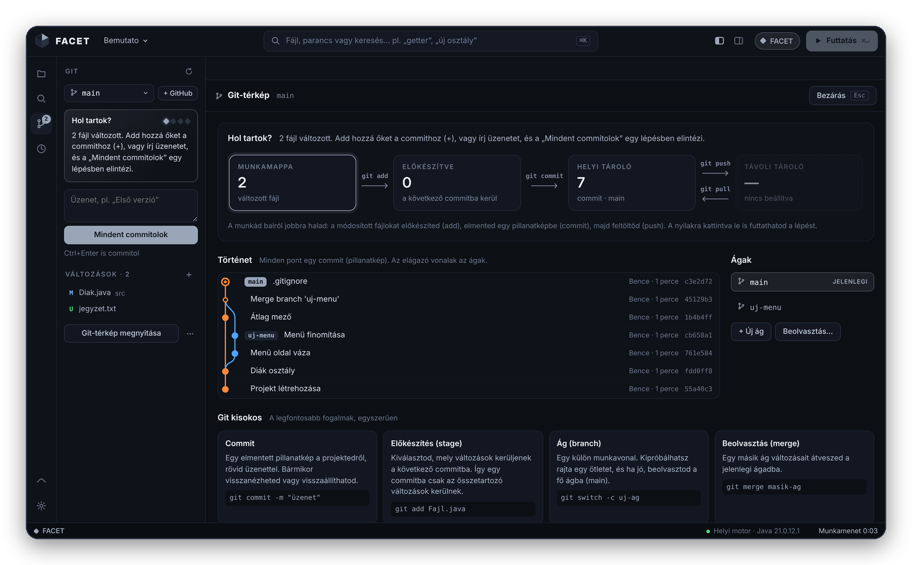

**„Hol tartok?”** Egy mondatban megmondja a következő lépést. A **Git-térkép** megmutatja, hol tart a munkád (munkamappa → előkészítve → helyi → távoli), a commitokat ágakkal együtt, és tartalmaz egy kisokost is. **Minden művelet kiírja a lefuttatott parancsot**, így közben a Gitet is megtanulod.

<details>
<summary><b>Az összes Git-funkció</b></summary>
<br>

- Változások, előkészítés (+ / −), commit, ágváltás, új ág, beolvasztás, pull, push, stash.
- Távoli tároló (GitHub) beállítása egy lépésben.
- Hibák magyarul, megoldással: nincs beállítva név, nincs távoli tároló, előbb pull kell…
- A szerkesztő szélén jelöli a megváltozott sorokat (új, módosított, törölt).

</details>

<br>

## 📄 Dokumentum — mini Word

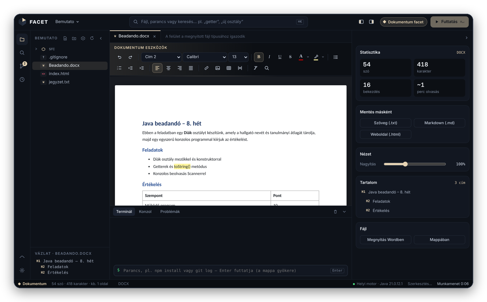

**`.docx` szerkesztése papírnézetben**, saját DOCX-olvasóval és -íróval. A mentett fájl szabványos `.docx`, Wordben és LibreOffice-ban is megnyílik. Az eredetiről az első mentés előtt biztonsági másolat készül.

<details>
<summary><b>Az összes dokumentum-funkció</b></summary>
<br>

- Címsorok, betűtípus és -méret, félkövér, dőlt, aláhúzott, áthúzott, szín és kiemelés.
- Felsorolás és számozás, igazítás, behúzás, hivatkozás, kép (beillesztve vagy behúzva), táblázat, oldaltörés.
- Keresés és csere, statisztika (szó, karakter, olvasási idő), tartalomjegyzék.
- `.txt` ugyanabban a nézetben, egy kattintással `.docx`-szé alakítható.
- Mentés másként: `.docx`, `.txt`, `.md`, `.html`.

</details>

<br>

## 🧰 Minden fájlhoz

<table>
<tr>
<td width="50%" valign="top">

**📁 Mappák, mint a VS Code-ban**<br>
Te nyitod meg a mappát, a fájlfa csukva indul, és a legutóbbi mappák kéznél vannak.

</td>
<td width="50%" valign="top">

**🕰️ Időgép**<br>
Minden mentésről pillanatkép. Csúszkával visszatekerhető, összehasonlítható és visszaállítható, git nélkül is.

</td>
</tr>
<tr>
<td valign="top">

**💻 Terminál-parancsmód**<br>
Ha épp nem fut program, bármilyen parancsot beírhatsz (`npm install`, `git log`…). A nyilakkal előhozod a korábbiakat.

</td>
<td valign="top">

**🧘 Flow mód és bezárható panelek**<br>
Csak a kód marad. A bal és a jobb panel külön is becsukható.

</td>
</tr>
<tr>
<td valign="top">

**🔎 Keresés a projektben**<br>
Minden fájlban egyszerre, találatra ugrással.

</td>
<td valign="top">

**🧹 Tiszta projektmappák**<br>
A FACET semmit nem ír a mappáidba: az Időgép, a fordítás és a kuka a `~/.facet`-ben van.

</td>
</tr>
<tr>
<td valign="top">

**🖱️ Húzd és ejtsd**<br>
Fájlok és mappák áthelyezése a fában húzással, fájlok behúzása a Finderből/Intézőből, fülek átrendezése.

</td>
<td valign="top">

**↩️ Vissza az előző helyre**<br>
Az egér vissza/előre gombja (és <kbd>Alt</kbd> <kbd>←</kbd>) a kódban lépked vissza oda, ahol jártál.

</td>
</tr>
</table>

<br>

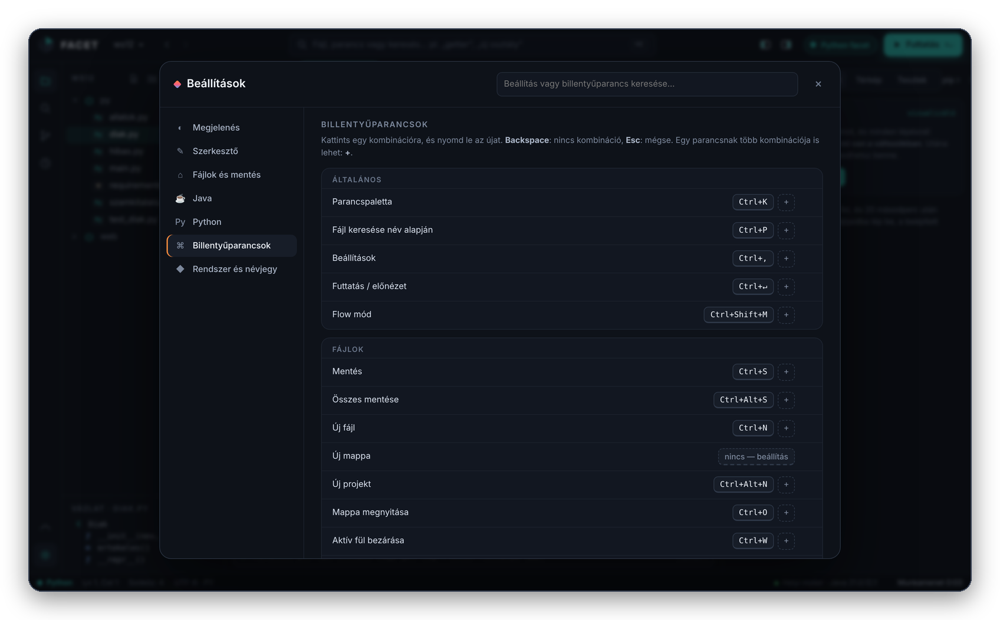

**Beállítások** (<kbd>⌘</kbd> <kbd>,</kbd> / <kbd>Ctrl</kbd> <kbd>,</kbd>): kereshető oldal kategóriákkal — megjelenés, szerkesztő, mentés, Java, Python —, **átírható billentyűparancsokkal**, ütközésfigyeléssel, exporttal és importtal. Az ablak nagyítható: <kbd>Ctrl</kbd> <kbd>+</kbd> / <kbd>−</kbd> / <kbd>0</kbd>.

<br>

<a id="letoltes"></a>

## ⬇ Letöltés

<div align="center">

<a href="https://github.com/BBencht/FacetCode/releases/latest"></a>

</div>

| | Rendszer | Fájl |
|:---:|---|---|
| 🍎 | **macOS** · Apple Silicon és Intel | `FACET_1.2.0_universal.dmg` |
| 🪟 | **Windows 10 / 11** | `FACET_1.2.0_x64-setup.exe` vagy `.msi` |
| 🐧 | **Linux** | `.AppImage`, `.deb` (Ubuntu, Debian) vagy `.rpm` (Fedora) |

### Három lépés, és kész

1. **Telepíts egy Javát**, ha még nincs: [Eclipse Temurin 21](https://adoptium.net). Windowson pipáld be a *Set JAVA_HOME* lehetőséget, macOS-en pedig mehet ez is: `brew install --cask temurin`.
2. **Töltsd le és telepítsd** a FACET-et a fenti táblázatból.
3. **Indítsd el**, és nyiss meg egy mappát. Ennyi.

> [!NOTE]
> A **Git** ([git-scm.com](https://git-scm.com)) és a **Node.js** ([nodejs.org](https://nodejs.org)) nem kötelező. A FACET magától észreveszi, ha telepítve vannak, és akkor bekapcsolja a Git-panelt, illetve a JavaScript-futtatást.

<details>
<summary><b>🍎 macOS: „A FACET nem nyitható meg”</b></summary>
<br>

A FACET nincs fizetős Apple-tanúsítvánnyal aláírva, ezért a macOS az első indításnál megállítja.

1. Próbáld megnyitni egyszer, majd a figyelmeztetésnél nyomd meg a **Kész** gombot.
2. Nyisd meg ezt: **Rendszerbeállítások → Adatvédelem és biztonság**.
3. Görgess le, és kattints a **Megnyitás mindenképp** gombra.

Ha „sérült”-nek írja, futtasd ezt egyszer a Terminálban:

```bash
xattr -cr /Applications/FACET.app
```
</details>

<details>
<summary><b>🪟 Windows: „A Windows megvédte a számítógépet”</b></summary>
<br>

Kattints a **További információ**, majd a **Futtatás mindenképp** gombra. Erre csak az első telepítésnél van szükség.
</details>

<details>
<summary><b>🧯 A FACET nem indul el</b></summary>
<br>

- **„Kell egy Java”** vagy **„Túl régi a Java”**: telepítsd a [Temurin 21](https://adoptium.net)-et. A régi Java maradhat mellette, a FACET magától az újabbat választja.
- **Egyéb hiba:** a hibaablakban kattints a **Részletek** gombra. Ott látod a pontos hibát és a naplófájl helyét (`facet-engine.log` a rendszer ideiglenes mappájában). Ezzel nyiss egy [hibajegyet](https://github.com/BBencht/FacetCode/issues).
</details>

<br>

<a id="billentyuk"></a>

## ⌨️ Billentyűk

| Mit csinál | macOS | Windows / Linux |
|---|:---:|:---:|
| Parancspaletta | <kbd>⌘</kbd> <kbd>K</kbd> | <kbd>Ctrl</kbd> <kbd>K</kbd> |
| Fájl keresése | <kbd>⌘</kbd> <kbd>P</kbd> | <kbd>Ctrl</kbd> <kbd>P</kbd> |
| Mappa megnyitása | <kbd>⌘</kbd> <kbd>O</kbd> | <kbd>Ctrl</kbd> <kbd>O</kbd> |
| Futtatás / előnézet | <kbd>⌘</kbd> <kbd>↵</kbd> | <kbd>Ctrl</kbd> <kbd>Enter</kbd> |
| Mentés · mind | <kbd>⌘</kbd> <kbd>S</kbd> · <kbd>⌥</kbd> <kbd>⌘</kbd> <kbd>S</kbd> | <kbd>Ctrl</kbd> <kbd>S</kbd> · <kbd>Alt</kbd> <kbd>Ctrl</kbd> <kbd>S</kbd> |
| Új fájl · új projekt | <kbd>⌘</kbd> <kbd>N</kbd> · <kbd>⌥</kbd> <kbd>⌘</kbd> <kbd>N</kbd> | <kbd>Ctrl</kbd> <kbd>N</kbd> · <kbd>Alt</kbd> <kbd>Ctrl</kbd> <kbd>N</kbd> |
| Keresés a projektben | <kbd>⇧</kbd> <kbd>⌘</kbd> <kbd>F</kbd> | <kbd>Shift</kbd> <kbd>Ctrl</kbd> <kbd>F</kbd> |
| Formázás | <kbd>⇧</kbd> <kbd>⌥</kbd> <kbd>F</kbd> | <kbd>Shift</kbd> <kbd>Alt</kbd> <kbd>F</kbd> |
| Bal · jobb · alsó panel | <kbd>⌘</kbd> <kbd>B</kbd> · <kbd>⌥</kbd> <kbd>⌘</kbd> <kbd>B</kbd> · <kbd>⌘</kbd> <kbd>J</kbd> | <kbd>Ctrl</kbd> <kbd>B</kbd> · <kbd>Alt</kbd> <kbd>Ctrl</kbd> <kbd>B</kbd> · <kbd>Ctrl</kbd> <kbd>J</kbd> |
| Flow mód (teljes képernyő) | <kbd>⇧</kbd> <kbd>⌘</kbd> <kbd>M</kbd> | <kbd>Shift</kbd> <kbd>Ctrl</kbd> <kbd>M</kbd> |
| Vissza · előre a kódban | <kbd>⌃</kbd> <kbd>-</kbd> · <kbd>⌃</kbd> <kbd>⇧</kbd> <kbd>-</kbd> | <kbd>Alt</kbd> <kbd>←</kbd> · <kbd>Alt</kbd> <kbd>→</kbd> |
| Ablak nagyítása | <kbd>⌘</kbd> <kbd>+</kbd> · <kbd>⌘</kbd> <kbd>−</kbd> · <kbd>⌘</kbd> <kbd>0</kbd> | <kbd>Ctrl</kbd> <kbd>+</kbd> · <kbd>Ctrl</kbd> <kbd>−</kbd> · <kbd>Ctrl</kbd> <kbd>0</kbd> |
| Beállítások | <kbd>⌘</kbd> <kbd>,</kbd> | <kbd>Ctrl</kbd> <kbd>,</kbd> |

Mindegyik átírható a **Beállítások → Billentyűparancsok** oldalon.

<br>

## 🧩 Hogyan működik?

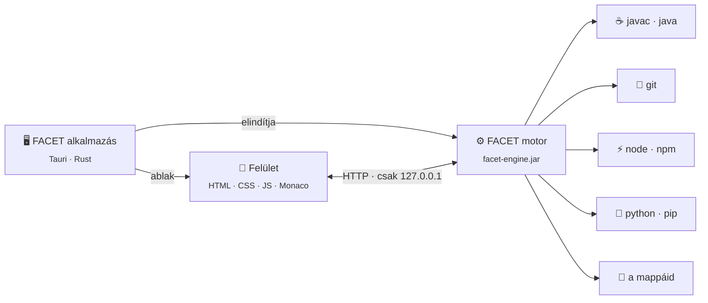

| Réteg | Mi ez? |
|---|---|
| **Tauri-héj** · `src-tauri/` | Vékony Rust-réteg: megkeresi a Javát, elindítja a motort, megnyitja az ablakot. A rendszer saját böngészőmotorját használja, ezért a telepítő csak néhány MB. |
| **Motor** · `engine/Facet.java` | Egyetlen Java-fájl, külső függőség nélkül. Ez kezeli a fájlokat, a fordítást, a futtatást, a Gitet, a Node-ot, a Pythont és a `.docx` fájlokat. Csak a saját gépről és csak a FACET felületéről fogad kéréseket. |
| **Felület** · `web/` | Sima HTML, CSS és JavaScript, keretrendszer nélkül. Minden fájltípus egy facet modul, így egy új nyelv egy új fájl. |

<br>

<a id="forrasbol"></a>

## 🛠️ Fejlesztés forrásból

```bash
git clone https://github.com/BBencht/FacetCode.git
cd FacetCode
npm install          # Tauri CLI, Monaco, Emmet
npm run icons        # ikonok az app-icon.png-ből
npm run dev          # fejlesztői mód
npm run build        # telepítő a saját rendszeredre
```

Kell hozzá: JDK 11+, Node.js 18+ és [Rust](https://rustup.rs). macOS-en ezen felül az Xcode Command Line Tools, Linuxon a `libwebkit2gtk-4.1-dev`.

> [!TIP]
> **Gyors kipróbálás Rust nélkül:** `java engine/Facet.java`, utána nyisd meg a <http://localhost:7777> címet a böngészőben.

<details>
<summary><b>Projektszerkezet és automatikus build</b></summary>
<br>

```
FacetCode/
├── engine/Facet.java          a motor (fájlok, fordítás, futtatás, Git, Node, DOCX)
├── web/                       a felület
│   ├── index.html · facet.css
│   └── js/  core · java · web · jsplus · git · doc · samples
├── src-tauri/                 asztali alkalmazás (Rust + Tauri 2)
│   ├── src/main.rs            Java keresése, motor indítása, ablak
│   └── loader/                indulóképernyő és hibaüzenetek
├── scripts/prepare.mjs        motor fordítása, felület és szerkesztő csomagolása
└── .github/workflows/         build macOS-re, Windowsra, Linuxra
```

Minden push után a GitHub Actions elkészíti a három rendszer telepítőit. Egy `v*` címkével (pl. `v1.2.0`) létrehozott kiadáshoz a telepítők automatikusan felkerülnek.
</details>

<br>

## 📜 Változásnapló

<details open>
<summary><b>1.2.0</b> · Python, átírható billentyűk, húzd és ejtsd</summary>
<br>

- **Python facet:** futtatás `input()`-tal, magyar Traceback-magyarázat, élő szintaxis-ellenőrzés, tanácsok gyors javítással, **lépésenkénti futtatás változókkal**, térkép és UML-export, tesztek (pytest/unittest), generátorok, pip/venv panel, konzol, black-formázás, Python-mintaprojekt.
- **Új Beállítások oldal:** keresés, kategóriák, rendszerinformáció, export/import — és **átírható billentyűparancsok** ütközésfigyeléssel.
- **Ablak nagyítása:** <kbd>Ctrl</kbd> <kbd>+</kbd> / <kbd>−</kbd> / <kbd>0</kbd> (a <kbd>Ctrl</kbd> + görgő továbbra is a szerkesztőt nagyítja).
- **Húzd és ejtsd:** áthelyezés a fájlfában (Java-fájlnál a `package` sort is frissíti), fájlok behúzása a gépről, fülek átrendezése.
- **Az egér vissza/előre gombja** a kódban lépked, nem lép ki a szerkesztőből.
- **Flow mód teljes képernyőn**, állítható szélességgel.
- Az új fájlok nem kapnak alapból megjegyzést.
- A beállítások újraindítás után is megmaradnak (`~/.facet/prefs.json`).
- Magyar billentyűzeten az AltGr-rel írt jelek (`{ } [ ] @`) többé nem indítanak parancsot.
</details>

<details>
<summary><b>1.1.1</b> · Windows-javítás</summary>
<br>

- A motor egyes Windows-gépeken nem indult el („A motor nem indult el időben”). Javítva a Windows hosszú útvonalainak (`\\?\`) kezelése.
- Okosabb Java-keresés: csak 11-es vagy újabb Javát választ, és megtalálja az IntelliJ által letöltött JDK-kat (`~/.jdks`) is. Ha csak régi Java van a gépen, ezt világosan jelzi.
- Ha a motor mégsem indul el, a hibaablak megmutatja a részleteket és a naplófájl helyét.
</details>

<details>
<summary><b>1.1.0</b> · Asztali alkalmazás, Git, JavaScript, mini Word</summary>
<br>

- Asztali alkalmazás Taurival macOS-re, Windows 10/11-re és Linuxra, automatikus GitHub-builddel.
- **Git:** panel, „Hol tartok?” segéd, Git-térkép (négy terület, commit-gráf, ágak), kisokos, magyar hibamagyarázat, megváltozott sorok jelölése.
- **UML-export** `.uxf` formátumba (UMLet).
- **Mini Word:** `.docx` és `.txt` szerkesztése papírnézetben, saját DOCX-olvasóval és -íróval.
- **JavaScript:** Node.js-futtatás, magyar hibamagyarázat, tanácsok gyors javítással, npm-panel, JSDoc.
- Terminál-parancsmód, bezárható panelek, mappamegnyitás a VS Code mintájára, IntelliJ-szerű projekthatárok.
- A szerkesztő internet nélkül is működik, mert a Monaco az alkalmazás része.
</details>

<details>
<summary><b>1.0</b> · Az első FACET</summary>
<br>

- Facet-váltás, Hibatolmács, osztálytérkép, Időgép, élő előnézet, parancspaletta.
</details>

<br>

## ⚖️ Licenc

A FACET [MIT-licenc](LICENSE) alatt érhető el: szabadon használhatod, módosíthatod és továbbadhatod, akár üzleti célra is. Csak a licencszöveget és a szerző nevét kell megtartani a másolatokban.

<br>

<div align="center">

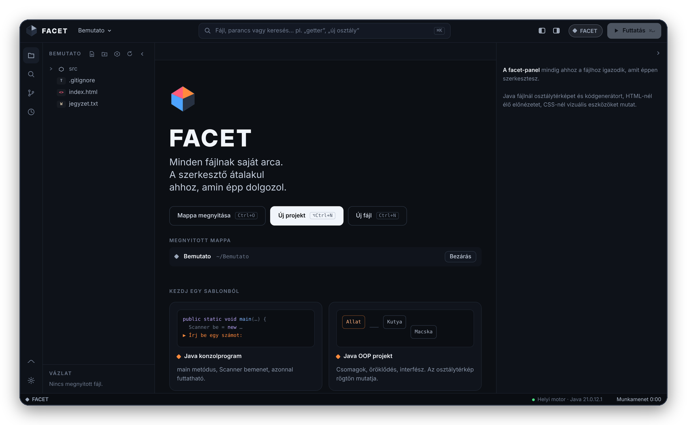

<br><br>

<sub>Készült ◆ Magyarországon · <b>FACET 1.2.0</b> · <a href="https://github.com/BBencht">@BBencht</a></sub>

</div>
