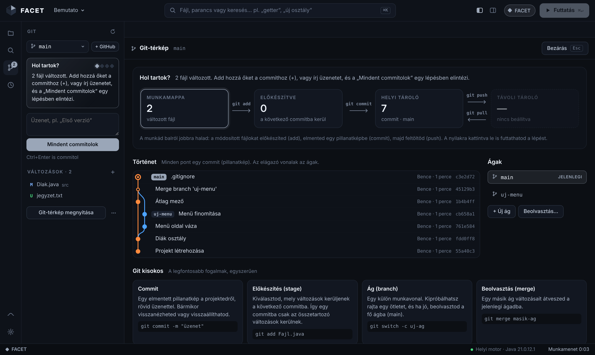
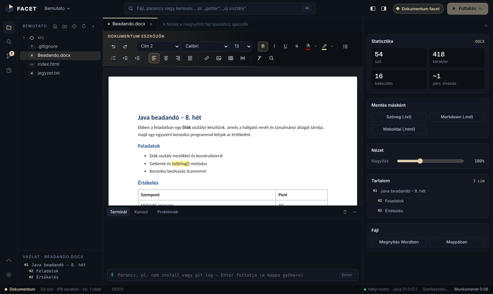
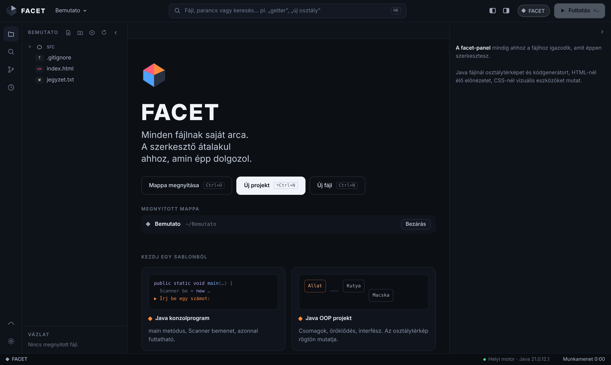
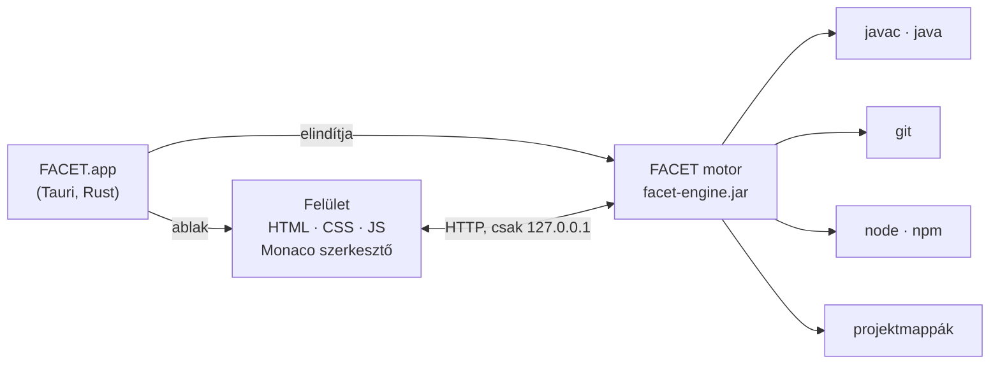

<p align="center">
  
</p>

<p align="center">
  <a href="https://github.com/BBencht/FacetCode/releases/latest"></a>
  
  
  <a href="https://github.com/BBencht/FacetCode/actions"></a>
</p>

<p align="center">
  <b>A FACET egy fejlesztői környezet, ami átalakul ahhoz, amin épp dolgozol.</b><br>
  Java-fájlnál Java-eszközöket látsz, HTML-nél élő előnézetet, Word-dokumentumnál szövegszerkesztőt.<br>
  Az eszköztár, a jobb oldali panel, a színek és a parancsok mind a fájl típusához igazodnak.
</p>

---

## Tartalom

- [Képek](#képek)
- [Letöltés és telepítés](#letöltés-és-telepítés)
- [Amit a FACET tud](#amit-a-facet-tud)
- [Billentyűk](#billentyűk)
- [Hogyan működik?](#hogyan-működik)
- [Fejlesztés és építés forrásból](#fejlesztés-és-építés-forrásból)
- [Változásnapló](#változásnapló)

## Képek

<p align="center">
  
  <br><sub><b>Git-térkép</b> — hol tart a munkád (munkamappa → előkészítve → helyi → távoli), a commitok gráfja ágakkal, és egy magyar Git kisokos.</sub>
</p>

<p align="center">
  
  <br><sub><b>Mini Word</b> — <code>.docx</code> és <code>.txt</code> szerkesztése papírnézetben, címsorokkal, listákkal, táblázattal, képpel.</sub>
</p>

<p align="center">
  
  <br><sub><b>Kezdőképernyő</b> — mappa megnyitása, új projekt sablonból, legutóbbi mappák.</sub>
</p>

## Letöltés és telepítés

A telepítők a **[Releases](https://github.com/BBencht/FacetCode/releases/latest)** oldalon vannak.

| Rendszer | Fájl | Megjegyzés |
|---|---|---|
| **macOS** (Apple Silicon és Intel) | `FACET_1.1.1_universal.dmg` | Húzd a FACET-et az Alkalmazások mappába. |
| **Windows 10 / 11** | `FACET_1.1.1_x64-setup.exe` vagy `.msi` | Ha hiányzik a WebView2, a telepítő automatikusan letölti. |
| **Linux** | `.AppImage`, `.deb` vagy `.rpm` | Az AppImage-et futtathatóvá kell tenni: `chmod +x FACET*.AppImage` |

### Egyetlen előfeltétel: Java (JDK 11 vagy újabb)

A FACET motorja és a Java-fordítás a gépen lévő JDK-t használja. Ha nincs Java a gépeden, a FACET indításkor megmondja, mit telepíts.

- **Ajánlott:** [Eclipse Temurin 21 (LTS)](https://adoptium.net) — macOS-en `.pkg`, Windowson `.msi` (telepítéskor pipáld be a „Set JAVA_HOME” lehetőséget).
- macOS-en Homebrew-val: `brew install --cask temurin`
- Linuxon: `sudo apt install openjdk-21-jdk`

Opcionális: a **Git** a verziókezeléshez ([git-scm.com](https://git-scm.com), macOS-en `xcode-select --install`), a **Node.js** pedig a JavaScript-futtatáshoz és az npm-hez ([nodejs.org](https://nodejs.org)).

### Első indítás

<details>
<summary><b>macOS: „A FACET nem nyitható meg, mert nem ellenőrizhető a fejlesztő”</b></summary>

A FACET nincs fizetős Apple fejlesztői tanúsítvánnyal aláírva, ezért a macOS első alkalommal megállítja.

1. Próbáld megnyitni egyszer (a figyelmeztetésnél nyomd meg a **Kész** gombot).
2. Nyisd meg a **Rendszerbeállítások → Adatvédelem és biztonság** panelt.
3. Görgess le, és kattints a **Megnyitás mindenképp** gombra.

Ha azt írja, hogy az alkalmazás „sérült”, futtasd ezt egyszer a Terminálban, majd nyisd meg újra:

```bash
xattr -cr /Applications/FACET.app
```
</details>

<details>
<summary><b>Windows: „A Windows megvédte a számítógépet” (SmartScreen)</b></summary>

Kattints a **További információ**, majd a **Futtatás mindenképp** gombra. Erre csak az első telepítésnél van szükség.
</details>

## Amit a FACET tud

### ◆ Facet-váltás — a felület átalakul
A megnyitott fájl kiterjesztése dönt: **Java**, **HTML**, **CSS**, **JavaScript**, **JSON**, **Markdown** vagy **Dokumentum**. Mindegyiknek saját színe, eszköztára, jobb oldali panelje és parancsai vannak. A ⌘K parancspaletta mindig az aktuális facet parancsait mutatja elöl, és magyarul is érti, amit keresel („getter”, „új osztály”, „formázd”).

### ☕ Java
- **Hibatolmács:** a fordító angol hibáit magyarul magyarázza el, közvetlenül a hibás sor alatt, egy kattintásos javítással (hiányzó `;`, hiányzó import, „Erre gondoltál: getNev?”, rossz fájlnév…). A futás közbeni kivételeknél (túlindexelés, `NullPointerException`, `NumberFormatException`…) megmondja, mi történt, és a saját kódod pontos sorára ugrik.
- **FACET-tanácsok:** észreveszi a tipikus kezdő csapdákat, például a szövegek `==`-vel való összehasonlítását, vagy a `nextInt()` után üres sort olvasó `nextLine()`-t.
- **Interaktív futtatás:** a `Scanner` bemenetét közvetlenül a terminálba írod, parancssori argumentumokkal együtt.
- **Okos projekthatárok, mint az IntelliJ-ben:** `src/`, `.iml`, `pom.xml` és Gradle felismerése. Egy mappában lehet sok `Task01`, `Task02`… saját `Main`-nel, és mindegyik külön fordul.
- **Osztálytérkép:** élő diagram öröklődéssel, interfészekkel és használati kapcsolatokkal. Egy tagra kattintva a kódban odaugrik.
- **UML-export `.uxf`-be:** egy gombnyomással UMLet / UMLetino diagram az osztályokból, mezőkkel, metódusokkal, láthatósággal és kapcsolatokkal.
- **Generátorok:** getter/setter, konstruktor, `toString()`, `equals()`/`hashCode()`, `main`, új osztály, interfész, enum vagy record. Kódkiegészítés automatikus importtal, sablonok (`sout`, `psvm`, `fori`, `scanner`, `readint`…), formázó.

### 🌐 HTML és CSS
- **Élő előnézet** telefon, tablet és asztali keretben, vagy mindhárom egyszerre. Gépelés közben, mentés nélkül frissül.
- **Kijelölés az oldalon:** ha az előnézetben rákattintasz egy elemre, a kurzor a HTML pontos sorára ugrik, CSS-fájlnál pedig a hozzá tartozó szabályra.
- **Oldal-ellenőrzés:** hiányzó `alt`, viewport, címsorrend, ismétlődő `id`, hiányzó fájlok.
- **CSS-eszközök:** a fájl színei egy kattintásos átszínezéssel, Flexbox- és Grid-építő, árnyéktervező, CSS-változó szerkesztő.
- Elempaletta (navigáció, kártya, űrlap, táblázat…), Emmet (`ul>li*3` + Tab), konzol.

### ⚡ JavaScript
- **Futtatás Node.js-ben** interaktív terminállal. Ha a szkriptet egy HTML-oldal tölti be, a FACET az élő előnézetben futtatja.
- **Magyar hibamagyarázat** a Node és a böngésző hibáihoz (`ReferenceError`, `TypeError: Cannot read properties of undefined`, hiányzó csomag…).
- **Tanácsok gyors javítással:** `==` → `===`, `var` → `let`, értékadás feltételben, ottfelejtett `debugger`.
- **npm-panel:** szkriptek egy kattintással (`npm run dev`), csomagok telepítése és eltávolítása, `npm init`.
- JSDoc-generátor, kódrészletek, `.jsx`/`.ts`/`.tsx` színezés.

### 📄 Dokumentum — mini Word
- `.docx` szerkesztése papírnézetben: címsorok, betűtípus és -méret, félkövér, dőlt, aláhúzott, áthúzott, szín és kiemelés, felsorolás és számozás, igazítás, behúzás, hivatkozás, kép (beillesztve vagy behúzva is), táblázat, oldaltörés, keresés és csere.
- Saját DOCX-olvasó és -író: a mentett fájl szabványos `.docx`, Wordben és LibreOffice-ban is megnyitható. Az eredeti fájlról az első mentés előtt biztonsági másolat készül.
- `.txt` ugyanabban a papírnézetben, és egy kattintással átalakítható `.docx`-szé.
- Mentés másként: `.docx`, `.txt`, `.md`, `.html`. Statisztika (szó, karakter, olvasási idő) és tartalomjegyzék.

### 🌿 Git — segédlettel
- **Git-panel:** változások, előkészítés (+ / −), commit, ágváltás, új ág, beolvasztás, letöltés és feltöltés, félretevés (stash), távoli tároló (GitHub) beállítása.
- **„Hol tartok?”:** egy mondatban megmondja a következő lépést („2 fájl változott…”, „1 commit vár feltöltésre…”).
- **Git-térkép:** a négy terület diagramja (munkamappa → előkészítve → helyi → távoli), kattintható parancsnyilakkal, commit-gráf ágakkal és Git kisokos.
- **Minden művelet megmutatja a lefuttatott parancsot** (`git add Main.java`), így közben megtanulod a Gitet is.
- A hibákat magyarul magyarázza el, és felajánlja a megoldást (nincs beállítva név, nincs távoli tároló, előbb pull kell…).
- A szerkesztő szélén jelöli a megváltozott sorokat (új, módosított, törölt).

### 🧰 Minden fájltípushoz
- **Mappák, mint a VS Code-ban:** te nyitod meg a mappát, a fájlfa csukva indul, és a legutóbbi mappák elérhetők.
- **Időgép:** minden mentésről pillanatkép. Csúszkával visszatekerhető, összehasonlítható és visszaállítható, git nélkül is.
- **Terminál-parancsmód:** ha épp nem fut program, bármilyen parancsot beírhatsz (`npm install`, `git log`…), a nyilakkal előhozva a korábbiakat.
- Bezárható bal és jobb panel, Flow mód, keresés a projektben, kukába (nem véglegesen) törlés.
- A FACET semmit nem ír a projektmappáidba: az Időgép, a fordítás és a kuka a `~/.facet` mappában van.

## Billentyűk

| macOS | Windows / Linux | Mit csinál |
|---|---|---|
| `⌘K` | `Ctrl+K` | Parancspaletta |
| `⌘P` | `Ctrl+P` | Fájl keresése |
| `⌘O` | `Ctrl+O` | Mappa megnyitása |
| `⌘↵` | `Ctrl+Enter` | Futtatás / előnézet |
| `⌘S` | `Ctrl+S` | Mentés (`⌥⌘S`: mind) |
| `⌘N` / `⌥⌘N` | `Ctrl+N` / `Alt+Ctrl+N` | Új fájl / új projekt |
| `⇧⌘F` | `Shift+Ctrl+F` | Keresés a projektben |
| `⇧⌥F` | `Shift+Alt+F` | Formázás |
| `⌘B` / `⌥⌘B` / `⌘J` | `Ctrl+B` / `Alt+Ctrl+B` / `Ctrl+J` | Bal / jobb / alsó panel |
| `⇧⌘M` | `Shift+Ctrl+M` | Flow mód |

## Hogyan működik?



- **A Tauri-héj** (`src-tauri/`) vékony réteg: megkeresi a Javát, elindítja a motort, és megnyitja az ablakot. A telepítő néhány MB, mert a rendszer saját böngészőmotorját használja.
- **A motor** (`engine/Facet.java`) egyetlen Java-fájl, külső függőség nélkül. Ez kezeli a fájlokat, a fordítást, a futtatást, a Gitet, a Node-ot és a `.docx` fájlokat. Csak a saját gépről és csak a FACET felületéről fogad kéréseket.
- **A felület** (`web/`) sima HTML, CSS és JavaScript, keretrendszer nélkül. Minden fájltípus egy facet modul, ezért egy új nyelv egy új fájl.

## Fejlesztés és építés forrásból

```bash
git clone https://github.com/BBencht/FacetCode.git
cd FacetCode
npm install                 # Tauri CLI, Monaco, Emmet
npm run icons               # ikonok az app-icon.png-ből
npm run dev                 # fejlesztői mód
npm run build               # telepítő a saját rendszeredre
```

Szükséges hozzá: JDK 11+, Node.js 18+, [Rust](https://rustup.rs), valamint macOS-en az Xcode Command Line Tools, Linuxon a `libwebkit2gtk-4.1-dev`.

**Gyors kipróbálás böngészőben** (Rust nélkül): `java engine/Facet.java`, utána nyisd meg a `http://localhost:7777` címet.

**Automatikus build:** minden push után a GitHub Actions elkészíti a macOS-, Windows- és Linux-telepítőket. Egy `v*` címke (pl. `v1.1.0`) feltöltésekor kiadás is készül a letölthető fájlokkal.

```
FacetCode/
├── engine/Facet.java          a motor (fájlok, fordítás, futtatás, Git, Node, DOCX)
├── web/                       a felület
│   ├── index.html · facet.css
│   └── js/  core · java · web · jsplus · git · doc · samples
├── src-tauri/                 asztali alkalmazás (Rust + Tauri 2)
│   ├── src/main.rs            Java keresése, motor indítása, ablak
│   └── loader/                indulóképernyő
├── scripts/prepare.mjs        motor fordítása + felület és szerkesztő csomagolása
└── .github/workflows/         build macOS-re, Windowsra, Linuxra
```

## Változásnapló

### 1.1.1
- **Windows-javítás:** a motor nem indult el egyes gépeken („A motor nem indult el időben”). Javítva a Windows hosszú útvonalainak (`\\?\`) kezelése.
- Okosabb Java-keresés: csak 11-es vagy újabb Javát választ, megtalálja az IntelliJ által letöltött JDK-kat (`~/.jdks`) is; ha csak régi Java van a gépen, ezt világosan jelzi.
- Ha a motor mégsem indul, a hibaablak megmutatja a részleteket és a naplófájl helyét.

### 1.1.0
- Asztali alkalmazás Taurival macOS-re, Windows 10/11-re és Linuxra, automatikus GitHub-builddel.
- **Git:** panel, „Hol tartok?” segéd, Git-térkép (négy terület, commit-gráf, ágak), kisokos, magyar hibamagyarázat, megváltozott sorok jelölése.
- **UML-export** `.uxf` formátumba (UMLet).
- **Mini Word:** `.docx` és `.txt` szerkesztése papírnézetben, saját DOCX-olvasóval és -íróval.
- **JavaScript:** Node.js-futtatás, magyar hibamagyarázat, tanácsok gyors javítással, npm-panel, JSDoc.
- Terminál-parancsmód, bezárható panelek, mappamegnyitás a VS Code mintájára, IntelliJ-szerű projekthatárok.
- A szerkesztő internet nélkül is működik (a Monaco az alkalmazás része).

### 1.0
- Az első FACET: facet-váltás, Hibatolmács, osztálytérkép, Időgép, élő előnézet, parancspaletta.

---

<p align="center"><sub>Készült ◆ Magyarországon · FACET 1.1.1</sub></p>
